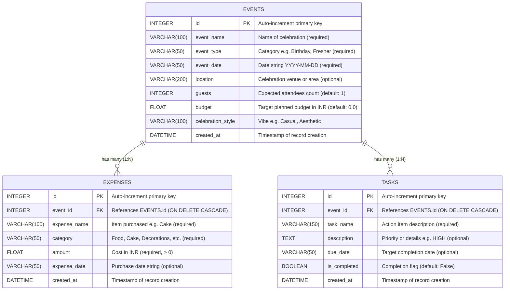

# Database Design & Architecture: PlanzyPop

**Database Engine:** SQLite 3  
**Database File Location:** `backend/planzypop.db`  
**ORM Framework:** SQLAlchemy 2.x  
**Schema Creation Strategy:** Automated code-first initialization via `models.Base.metadata.create_all(bind=engine)`

---

## 1. Why SQLite Was Selected

For an M.Sc. Computer Science academic mini-project, SQLite offers significant architectural advantages:
1. **Serverless & Zero Configuration:** SQLite runs embedded in the Python process without requiring a separate database daemon process, user credentials, or network port binding.
2. **ACID Compliant:** SQLite fully supports Atomic, Consistent, Isolated, and Durable transactions, ensuring transactional reliability during event, expense, and task updates.
3. **Single File Storage:** The entire database resides in `backend/planzypop.db`, making backup, project distribution, and teacher evaluation straightforward.
4. **Relational Integrity:** SQLite enforces table constraints, primary keys, and foreign keys when properly configured with SQLAlchemy.

---

## 2. Entity-Relationship (ER) Diagram



---

## 3. Relational Table Specifications

### Table 1: `events`
Stores core celebration records created by the host.

| Column Name | SQLite Data Type | Constraints | Description |
| :--- | :--- | :--- | :--- |
| `id` | `INTEGER` | Primary Key, Auto-increment | Unique synthetic identifier for the event. |
| `event_name` | `VARCHAR(100)` | Not Null, Index=True | Title of the event (e.g. "Rohan's 21st Birthday"). |
| `event_type` | `VARCHAR(50)` | Not Null | Classification (e.g. Birthday, Fresher, House Party). |
| `event_date` | `VARCHAR(50)` | Not Null | Date of celebration in ISO format (`YYYY-MM-DD`). |
| `location` | `VARCHAR(200)` | Nullable | Venue address or hostel block. |
| `guests` | `INTEGER` | Not Null, Default = 1 | Total number of participating friends. |
| `budget` | `FLOAT` | Not Null, Default = 0.0 | Host's targeted total expenditure limit in INR. |
| `celebration_style` | `VARCHAR(100)` | Nullable | Aesthetic preference (e.g. "Casual", "DIY"). |
| `created_at` | `DATETIME` | Not Null, Default = `utcnow` | Audit timestamp of when the event was registered. |

### Table 2: `expenses`
Stores individual expenditure line items linked to a parent event.

| Column Name | SQLite Data Type | Constraints | Description |
| :--- | :--- | :--- | :--- |
| `id` | `INTEGER` | Primary Key, Auto-increment | Unique identifier for each expense item. |
| `event_id` | `INTEGER` | Foreign Key (`events.id`), Not Null | Links expense directly to its parent event. |
| `expense_name` | `VARCHAR(100)` | Not Null | Description of purchase (e.g. "Chocolate Truffle Cake"). |
| `category` | `VARCHAR(50)` | Not Null | Standard category (`Food`, `Decorations`, `Cake`, etc.). |
| `amount` | `FLOAT` | Not Null | Transaction cost in Indian Rupees (₹). |
| `expense_date` | `VARCHAR(50)` | Nullable | Date when the purchase occurred. |
| `created_at` | `DATETIME` | Not Null, Default = `utcnow` | Audit timestamp of expense creation. |

### Table 3: `tasks`
Stores checklist items and timeline milestones for an event.

| Column Name | SQLite Data Type | Constraints | Description |
| :--- | :--- | :--- | :--- |
| `id` | `INTEGER` | Primary Key, Auto-increment | Unique identifier for each checklist task. |
| `event_id` | `INTEGER` | Foreign Key (`events.id`), Not Null | Links task directly to its parent event. |
| `task_name` | `VARCHAR(150)` | Not Null | Action description (e.g. "Pick up balloons from market"). |
| `description` | `TEXT` | Nullable | Priority badge (`HIGH`, `MEDIUM`, `LOW`) or note. |
| `due_date` | `VARCHAR(50)` | Nullable | Milestone deadline date (`YYYY-MM-DD`). |
| `is_completed` | `BOOLEAN` | Not Null, Default = `False` | Boolean toggle representing task completion. |
| `created_at` | `DATETIME` | Not Null, Default = `utcnow` | Audit timestamp of task creation. |

---

## 4. Primary Key & Foreign Key Relationships

### Primary Keys
- Every table has an integer primary key column named `id`.
- SQLite assigns `id` as an `AUTOINCREMENT` sequence, ensuring each entity has an immutable, unique identifier.

### Foreign Keys & Referential Integrity
- `expenses.event_id` references `events.id`.
- `tasks.event_id` references `events.id`.
- **Cascade Deletion (`ON DELETE CASCADE`):**  
  In `models.py`, both relationships are defined with `cascade="all, delete-orphan"`:
  ```python
  expenses = relationship("Expense", back_populates="event", cascade="all, delete-orphan")
  tasks = relationship("Task", back_populates="event", cascade="all, delete-orphan")
  ```
  When an event is deleted via `DELETE /events/{id}`, SQLAlchemy and SQLite automatically delete all associated expense rows and task rows. This prevents orphaned records and maintains database cleanliness.

---

## 5. Supported Expense Categories

To ensure consistency in category breakdowns, both the backend validation layer (`schemas.py`) and frontend interfaces (`types/index.ts`) enforce an identical list of 8 standard categories:
1. `Food` (snacks, platters, pizzas, rolls)
2. `Decorations` (balloons, fairy lights, streamers, photo backdrops)
3. `Cake` (custom cakes, pastries, cupcakes)
4. `Venue` (cafe table booking, cover charges, hall rent)
5. `Gifts` (party favors, return gifts, birthday surprises)
6. `Travel` (auto-rickshaw, cab pool, transit)
7. `Entertainment` (speaker rentals, board games, movie tickets)
8. `Other` (paper plates, napkins, miscellaneous supplies)
